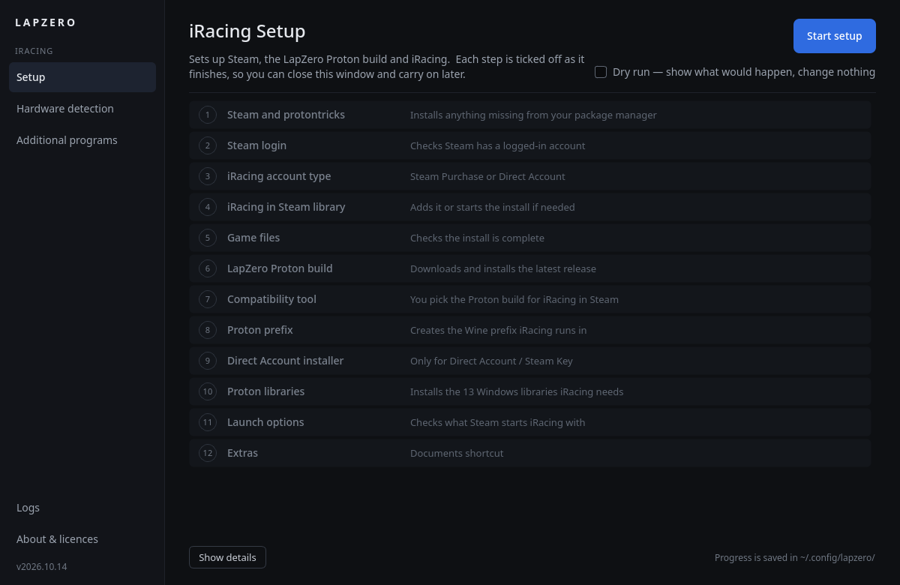
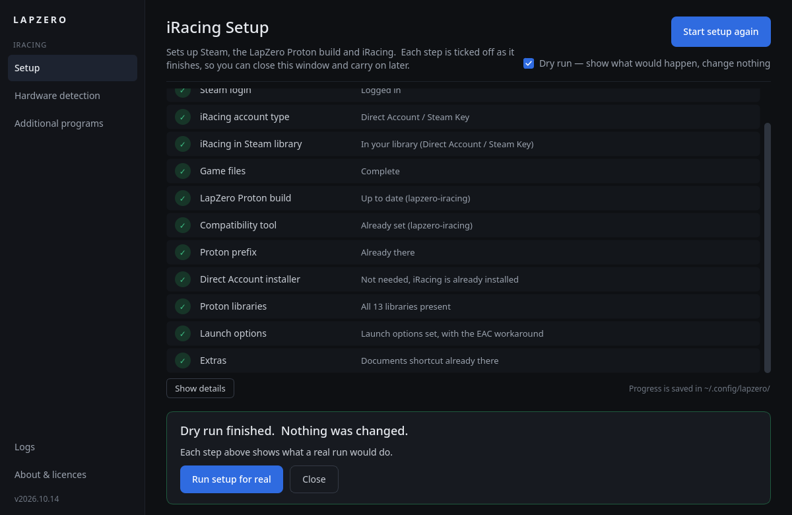
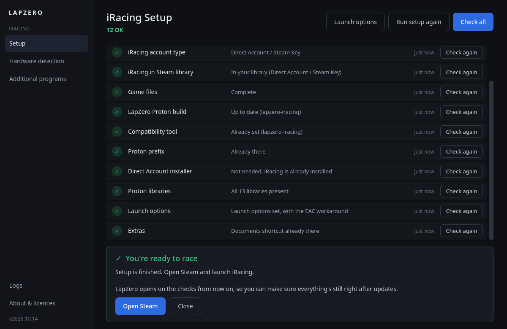

# LapZero

**The lap before the race. iRacing on Linux, from cold garage to grid.**

---

## Why "LapZero"?

In motorsport, the formation lap is sometimes called *lap zero* — the lap where everything gets checked, warmed up, and lined up before the lights go out.

LapZero is that lap, as software: everything that has to happen on a Linux machine *before* you can race on iRacing, handled in one place, with as little friction as possible.

## The Mission

iRacing does not officially support Linux. We think it should — and rather than just asking, we're proving it.

This project is the culmination of a body of work spanning setup scripts, apps, DXVK/dxvk-nvapi work, and upstream bug reports, all with one goal: **demonstrate that iRacing runs properly on Linux, and give iRacing every reason to flip the switch on anticheat support.**

Until that day, LapZero exists to get Linux sim racers as close to the grid as currently possible — Test Drive, Replays, and AI Racing all work today (at your own risk) — and to make sure that the moment official support lands, the Linux community is ready to race on day one.

## What LapZero Does

LapZero is a minimal-interaction setup and verification app for iRacing on Linux. Point it at your system and it takes care of the boring, error-prone parts:

- **System checks** — verifies Steam, Proton, and protontricks are present and correctly configured
- **iRacing detection** — handles iRacing whether it's added via a Steam account or as a direct account using a generated Steam key
- **Library management** — ensures every required library and protontricks component is installed in the right prefix
- **File access** — helps you find and work with iRacing's files in Documents inside the prefix
- **Clear verdicts** — tells you plainly what's working, what isn't, and what to do about it

## Screenshots

**First run.**  Every step is listed before anything happens.

**Dry run.**  Shows what setup would do, without changing anything.

**Ready to race.**  After setup, LapZero opens on these checks, each with its own Check again button.

## Install

Download the package for your distro from the [latest release](https://github.com/DanFraserUK/LapZero/releases/latest), then install it from the folder you saved it to.

| Distro | Package | Install with |
|---|---|---|
| Arch, CachyOS, EndeavourOS | `lapzero-<version>-arch-x86_64.pkg.tar.zst` | `sudo pacman -U ./lapzero-*-arch-x86_64.pkg.tar.zst` |
| Fedora | `lapzero-<version>-fedora-x86_64.rpm` | `sudo dnf install ./lapzero-*-fedora-x86_64.rpm` |
| Ubuntu 24.04, Linux Mint 22 | `lapzero-<version>-ubuntu-24.04-x86_64.deb` | `sudo apt install ./lapzero-*-ubuntu-24.04-x86_64.deb` |
| Ubuntu 22.04, Linux Mint 21 | `lapzero-<version>-ubuntu-22.04-x86_64.deb` | `sudo apt install ./lapzero-*-ubuntu-22.04-x86_64.deb` |
| Debian 12 | `lapzero-<version>-debian-12-x86_64.deb` | `sudo apt install ./lapzero-*-debian-12-x86_64.deb` |

Then open **LapZero** from your app menu.  `SHA256SUMS` in each release lets you check the download.

## Where It's Headed

Setup is only the first sector. On the roadmap:

- **Wheel, pedal, and rig support** — detect wheelbases, pedal sets, shifters, handbrakes, and button boxes; help configure and troubleshoot them on Linux
- **Guided fixes** — not just "something's wrong," but one-click or walked-through remediation
- **Distribution awareness** — install steps differ between Arch, Manjaro, EndeavourOS, Fedora, Debian and friends, and LapZero should know the difference
- **Companion software** — guidance for the wider ecosystem of sim racing tools alongside iRacing

## Current Status

> **GAME STATUS: KIND OF INOPERATIVE**
>
> Racing online is blocked by anticheat. Test Drive, Replays, and AI Racing are accessible at your own risk. Everything LapZero sets up works — the final step is iRacing's to take.

## Related Work & Inspiration

LapZero grew out of the [iRacing On Linux](https://github.com/DanFraserUK/iRacing-On-Linux) project — a collaborative effort documenting iRacing on Linux across distributions, peripherals, and companion software. If you want the manual walkthroughs or the per-distribution documentation, start there.

Where we're going is heavily inspired by the outstanding work at [simracingonlinux.com](https://simracingonlinux.com), which covers setup, hardware, and companion software across the whole spectrum of sim racing titles on Linux. We aim to bring that same breadth of functionality — hardware setup, companion tooling, the lot — into LapZero, with one deliberate difference in scope: **LapZero is for iRacing, and iRacing only.** For every other title, go give their work the attention it deserves.

## Why Closed Source?

LapZero can ask for your password.  I want one build of it out there, the one released here.  That way nobody can pass off a modified copy that does more with your password than it should.

If iRacing ever wants to talk about Linux support, I want LapZero to be easy to hand over.  One owner and no outside code makes that a short conversation.

## What LapZero Does as Root

Only one thing.  If Steam or protontricks is missing, LapZero installs it with your distro's package manager.  On Fedora, that includes the RPM Fusion repos Steam comes from.  Your desktop's own password window asks first.  If everything's already installed, LapZero never asks for your password.

Everything else runs as you, and every step is logged.  The Logs page shows the lot.

If LapZero finds the old EAC line from the setup script in `/etc/hosts`, it won't touch it.  It tells you where it is so you can take it out yourself.

## Contributing

If you're running iRacing on Linux — or trying to — your experience is data we want. Issues and reports from distributions we haven't covered are all welcome.  LapZero is closed source, so there's no code to send pull requests to.

---

*LapZero: because the race starts before the race starts.*
